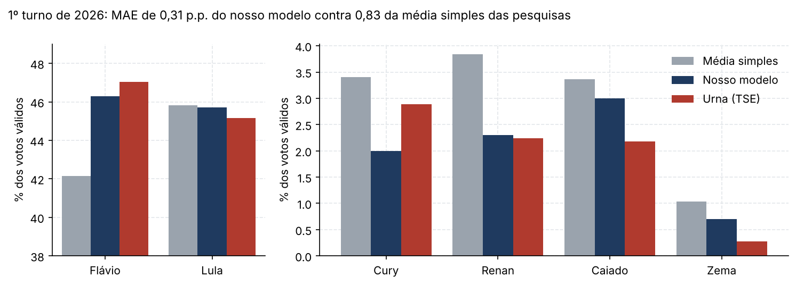
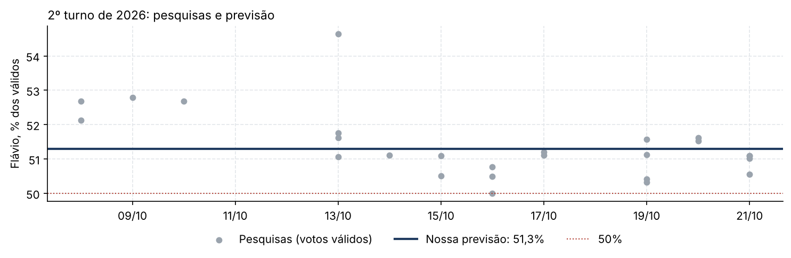
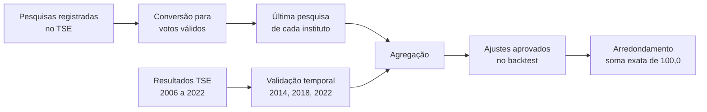

# Previsão da eleição presidencial de 2026

[](https://github.com/pvaluche/trabalho-econometria-a1/actions/workflows/ci.yml)


Modelo de agregação de pesquisas eleitorais para prever o 1º e o 2º turno da eleição presidencial brasileira de 2026, desenvolvido para o **Desafio de Estatística e Econometria da FGV EPGE**.

**Grupo:** João Pedro Valuche de Andrade Pereira, Lethicia Manfioletti Possamai e Arthur Caron Lyra.

---

## Resultados

### 1º turno (04/10/2026)

Previmos os votos válidos dos 12 candidatos. O erro absoluto médio (MAE) sobre todos eles ficou em **0,31 p.p.**, contra 0,83 p.p. da média simples das mesmas pesquisas. Isso é uma redução de cerca de 60% no erro.



| Candidato | Previsão | Urna (TSE) | Erro |
|---|---:|---:|---:|
| Flávio Bolsonaro (PL) | 46,3 | 47,03 | 0,73 |
| Luiz Inácio Lula da Silva (PT) | 45,7 | 45,16 | 0,54 |
| Ronaldo Caiado (PSD) | 3,0 | 2,18 | 0,82 |
| Renan Santos (Missão) | 2,3 | 2,24 | 0,06 |
| Augusto Cury (Avante) | 2,0 | 2,89 | 0,89 |
| Romeu Zema (Novo) | 0,7 | 0,27 | 0,43 |
| Outros 6 candidatos | 0,0 | 0,01 a 0,10 | 0,21 no total |
| **MAE (12 candidatos)** | | | **0,31** |

| Agregado | Previsão | Urna (TSE) | Erro |
|---|---:|---:|---:|
| Abstenção (% do eleitorado apto) | 22,3 | 21,08 | 1,22 |
| Votos brancos (% do comparecimento) | 1,6 | 1,84 | 0,24 |
| Votos nulos (% do comparecimento) | 2,8 | 2,93 | 0,13 |

Quase todo o ganho sobre a média simples veio de uma correção que estimamos no histórico. Nas eleições de 2006 a 2022, as pesquisas de véspera subestimaram de forma sistemática o principal adversário do PT. No caso de Flávio, o erro caiu de 4,9 p.p. na média simples para 0,7 p.p. no modelo final. O ponto mais fraco foi a abstenção, que subiu bem menos do que a tendência histórica indicava.

### 2º turno (25/10/2026)

> Previsão **preliminar**, com pesquisas até 21/10/2026. O corte final é no sábado, 24/10/2026, às 20h00.

| Candidato | Previsão |
|---|---:|
| Flávio Bolsonaro (PL) | **51,3** |
| Luiz Inácio Lula da Silva (PT) | **48,7** |

| Agregado | Previsão |
|---|---:|
| Abstenção (% do eleitorado apto) | 21,1 |
| Votos brancos (% do comparecimento) | 1,8 |
| Votos nulos (% do comparecimento) | 2,9 |



---

## Como o modelo funciona



1. **Votos válidos.** Cada pesquisa é convertida em votos válidos, $v_{ij} = x_{ij} / \sum_c x_{cj}$. Brancos, nulos e indecisos saem da conta, e os indecisos ficam distribuídos na proporção dos decididos.
2. **Uma pesquisa por instituto.** Usamos só a pesquisa mais recente de cada instituto, para que quem divulga com mais frequência não pese mais.
3. **Agregação e ajustes.** Comparamos modelos alternativos em backtest. Um modelo mais complexo só substitui o mais simples se reduzir o erro médio em mais de um erro-padrão da diferença.
4. **Arredondamento.** Usamos o método dos maiores restos, que garante soma exata de 100,0 com uma casa decimal.

### 1º turno

- **Testamos 4 agregadores:**
  - média simples;
  - ponderação por recência e tamanho da amostra;
  - correção do *house effect* de cada instituto;
  - regressão Ridge.

  A média simples venceu.
- **Dois ajustes passaram na regra:**
  - **Viés comum:** subtrai o erro médio histórico das pesquisas por bloco (PT, principal adversário e demais), encolhido por $N/(N+3)$.
  - **Voto útil:** transfere aos dois primeiros a perda média histórica do 3º e do 4º colocados na reta final.
- **Backtest:** MAE de 0,96 contra 1,22 da média simples.
- **Abstenção:** projetada por tendência linear. **Brancos e nulos:** por persistência.

### 2º turno

- **Agregador escolhido:** pondera cada instituto pelo erro que ele cometeu no 1º turno da mesma eleição, com $w_j = 1/(e_j^2 + \sigma_0^2)$. Quem errou menos três semanas antes pesa mais.
- **Backtest:** MAE de 0,65 contra 0,92 da média simples. Esse agregador venceu a média simples nas 5 eleições de 2006 a 2022.
- **Checagem independente:** aplicando ao 1º turno de 2026 a transferência histórica típica de votos dos eliminados, chegamos a 51,4% para Flávio, praticamente o mesmo número das pesquisas.
- **Abstenção, brancos e nulos:** repetem o valor do 1º turno de 2026. Nenhuma alternativa testada (variação entre turnos, razão média ou decomposição por UF) superou essa regra no backtest.

---

## Documentos

| Documento | 1º turno | 2º turno |
|---|---|---|
| Nota metodológica (2 páginas, entregue) | [PDF](docs/1t/metodologia.pdf) | [PDF](docs/2t/metodologia_2t.pdf) |
| Planilha de previsão (entregue) | [xlsx](outputs/previsao_2026.xlsx) | [xlsx](outputs/previsao_2026_2t.xlsx) |
| Relatório técnico completo | [PDF](docs/1t/relatorio_tecnico.pdf) | [relatório do backtest](reports/relatorio_backtest_2t.md) |
| Protocolo definido antes do backtest | [pré-registro](protocolo/PRE_REGISTRO_1T.md) | [protocolo](protocolo/PRE_REGISTRO_2T.md) |

---

## Como reproduzir

```bash
git clone https://github.com/pvaluche/trabalho-econometria-a1.git
cd trabalho-econometria-a1
python -m venv .venv
source .venv/bin/activate          # Windows: .\.venv\Scripts\Activate.ps1
pip install -r requirements.txt

pytest -q                          # testes automatizados
```

**1º turno:**

```bash
python scripts/executar_backtest_oficial.py     # backtest e outputs/previsao_2026.xlsx
python scripts/validar_entrega.py outputs/previsao_2026.xlsx
python scripts/gerar_numeros_latex.py           # números da nota em docs/1t/
```

**2º turno:**

```bash
python scripts/executar_backtest_2t.py          # backtest, relatório e outputs/previsao_2026_2t.xlsx
python scripts/gerar_numeros_latex_2t.py        # números, tabelas e figuras da nota em docs/2t/
cd docs/2t && pdflatex metodologia_2t.tex
```

**Figuras deste README:** `python scripts/gerar_figuras_readme.py`

Nenhum número das notas é digitado à mão. Planilhas, tabelas e figuras saem do mesmo código.

---

## Estrutura

```
├── src/              motor: conversão, agregação, backtest e geração das planilhas
├── scripts/          execução: coleta, backtests, planilhas, notas e figuras
├── tests/            testes automatizados (pytest)
├── data/
│   ├── manual/       pesquisas de 2026 transcritas, com registro TSE e fonte
│   ├── processed/    resultados do TSE e pesquisas históricas em Parquet
│   └── MANIFEST.csv  hash SHA-256 e data de cada arquivo baixado
├── outputs/          planilhas de previsão (1º e 2º turno)
├── docs/
│   ├── 1t/           nota metodológica e relatório técnico do 1º turno (LaTeX e PDF)
│   ├── 2t/           nota metodológica do 2º turno (LaTeX e PDF)
│   ├── img/          figuras deste README
│   └── processo/     entendimento do problema e instruções de trabalho
├── protocolo/        pré-registro, protocolo do 2º turno e registro de decisões
└── reports/          relatórios de cada etapa e do backtest do 2º turno
```

## Dados

- **TSE:** resultados oficiais de 2006 a 2026 por município e zona, do [portal de dados abertos](https://dadosabertos.tse.jus.br/). Os arquivos brutos ficam fora do Git (`data/raw/`). As versões processadas estão em `data/processed/`, e o hash de cada download, em `data/MANIFEST.csv`.
- **Pesquisas de 2026:** transcritas uma a uma, com número de registro no TSE, datas, amostra e link da fonte (`data/manual/`).
- **Pesquisas históricas:** 109 pesquisas de véspera do 1º turno e 111 de 2º turno, de 2006 a 2022.

## Como o trabalho foi feito

As regras de decisão de cada turno foram escritas antes de rodar o backtest e estão em `protocolo/`. As decisões e as revisões ao longo do projeto estão registradas em `protocolo/DECISOES.md` e `reports/`. Escrevemos o código com assistentes de IA sob nossa direção. As instruções que usamos estão em `docs/processo/`, e cada etapa passou por revisão antes de avançar.
