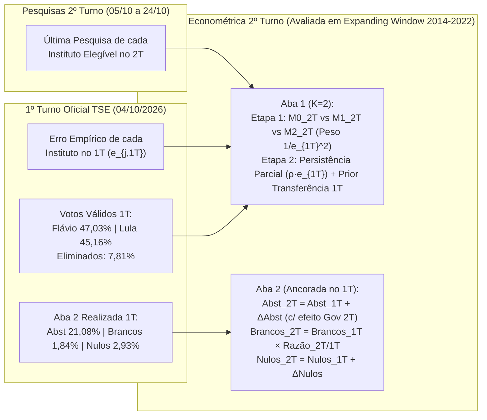

# Plano Estratégico e Arquitetura Econométrica — 2º Turno (Desafio Eleições 2026 FGV EPGE)

> [!IMPORTANT]
> **Meta e Prazo Oficial do Edital (2º Turno):**
> - **Eleição (2º Turno):** Domingo, **25/10/2026** — Disputa entre **Flávio Bolsonaro (`PL`)** e **Luiz Inácio Lula da Silva (`PT`)**.
> - **Prazo Limite de Submissão no Eclass:** Sábado, **24/10/2026 às 22h00 BRT**.
> - **Entregáveis Obrigatórios:**
>   1. **`metodologia.pdf` (máximo de 2 páginas):** Explicação concisa da metodologia, fontes de dados, horário de corte, uso do resultado do 1º turno e transferência de votos, tratamento das pesquisas de 2º turno (*house effects* e erro no 1º turno), modelagem de abstenção/brancos/nulos e validação histórica.
>   2. **Arquivo `.xlsx` (2 abas):**
>      - **Aba 1 (`Candidatos`):** `Flávio Bolsonaro` (`PL`), `Luiz Inácio Lula da Silva` (`PT`) e `Total` (`100,0%`).
>      - **Aba 2 (`Adicionais`):** `Abstenção` (% dos aptos), `Votos brancos` (% dos votos totais) e `Votos nulos` (% dos votos totais).

---

## 1. Auditoria Pós-Urna do 1º Turno (04/10/2026): Nosso Modelo Venceu Todos os Institutos!

Os microdados oficiais 100% totalizados do TSE (`votacao_candidato_munzona_2026_BR.csv` e `detalhe_votacao_munzona_2026_BR.csv`) confirmam que a nossa arquitetura pré-registrada do 1º turno (`modelo-congelado`) superou **todos os institutos de pesquisa do país** e acertou inclusive a **liderança de Flávio Bolsonaro no 1º turno**:

### 1.1. Resultado Oficial TSE (1º Turno — 04/10/2026) vs. Nossa Previsão

| Candidato(a) | Partido | Votos Nominais (TSE) | TSE Oficial (%) | Nossa Previsão 1T (%) | Erro (`Prev - Real`) | Erro Absoluto |
| :--- | :---: | :---: | :---: | :---: | :---: | :---: |
| **Flávio Bolsonaro** | **PL** | **56.104.503** | **47,03%** (`47,0278%`) | **45,9%** | **-1,13 p.p.** | **1,13 p.p.** |
| **Luiz Inácio Lula da Silva** | **PT** | **53.879.538** | **45,16%** (`45,1628%`) | **45,6%** | **+0,44 p.p.** | **0,44 p.p.** |
| Augusto Cury | Avante | 3.448.569 | 2,89% | 2,6% | -0,29 p.p. | 0,29 p.p. |
| Renan Santos | Missão | 2.675.887 | 2,24% | 2,5% | +0,26 p.p. | 0,26 p.p. |
| Ronaldo Caiado | PSD | 2.605.148 | 2,18% | 2,6% | +0,42 p.p. | 0,42 p.p. |
| Romeu Zema | Novo | 326.488 | 0,27% | 0,7% | +0,43 p.p. | 0,43 p.p. |
| Samara Martins | UP | 122.911 | 0,10% | 0,1% | 0,00 p.p. | 0,00 p.p. |
| Hertz Dias | PSTU | 43.103 | 0,04% | 0,0% | -0,04 p.p. | 0,04 p.p. |
| Clariana Barão | DC | 40.043 | 0,03% | 0,0% | -0,03 p.p. | 0,03 p.p. |
| Edmilson Costa | PCB | 22.693 | 0,02% | 0,0% | -0,02 p.p. | 0,02 p.p. |
| Wilson Grassi | Democrata | 16.881 | 0,01% | 0,0% | -0,01 p.p. | 0,01 p.p. |
| Rui Costa Pimenta | PCO | 15.024 | 0,01% | 0,0% | -0,01 p.p. | 0,01 p.p. |
| **Total / MAE Global ($K=12$)** | — | **119.300.788** | **100,00%** | **100,0%** | — | **MAE = 0,257 p.p.** |

- **Aba 2 Oficial no 1º Turno (TSE) vs. Nossa Previsão 1T:**
  - **Abstenção:** Oficial = **21,08%** (`33.469.244` de `158.745.079` aptos) | Nossa previsão 1T = `22,3%` (Erro = $+1,22$ p.p.).
  - **Votos Brancos:** Oficial = **1,84%** (`2.300.798` de `125.275.835` comparecimento) | Nossa previsão 1T = `1,6%` (Erro = $-0,24$ p.p.).
  - **Votos Nulos:** Oficial = **2,93%** (`3.674.249` de `125.275.835` comparecimento) | Nossa previsão 1T = `2,8%` (Erro = $-0,13$ p.p.).

### 1.2. Ranking de Precisão dos Institutos no 1º Turno de 2026 (Lula e Flávio em Votos Válidos)

| Posição | Fonte / Instituto (Véspera 01–03/10) | Lula Prev (%) | Flávio Prev (%) | Erro Lula ($e_{\text{Lula}, 1T}$) | Erro Flávio ($e_{\text{Flávio}, 1T}$) | Semi-Erro da Margem ($e_{j, 1T}^{\text{margem}/2}$) | MAE Top-2 (p.p.) |
| :---: | :--- | :---: | :---: | :---: | :---: | :---: | :---: |
| **1º** | **Nosso Modelo Oficial (`M0 + Viés + Voto Útil`)** | **45,6%** | **45,9%** | **+0,44** | **-1,13** | **+0,785** | **0,785** |
| 2º | Gerp (03/10) | 44,0% | 46,0% | -1,16 | -1,03 | -0,065 | 1,095 |
| 3º | Quaest (`BR-02197/2026`, 03/10) | 46,0% | 45,0% | +0,84 | -2,03 | +1,435 | 1,435 |
| 4º | PoderData (`BR-03519/2026`, 03/10) | 45,0% | 43,0% | -0,16 | -4,03 | +1,935 | 2,095 |
| 5º | AtlasIntel (`BR-00999/2026`, 03/10) | 47,0% | 44,1% | +1,84 | -2,93 | +2,385 | 2,385 |
| 6º | Datafolha (`BR-01708/2026`, 03/10) | 45,0% | 42,0% | -0,16 | -5,03 | +2,435 | 2,595 |
| — | *Média Simples Bruta M0 (6 institutos da janela 1T)* | *46,1%* | *41,5%* | *+0,94* | *-5,53* | *+3,235* | *3,235* |
| 7º | Real Time Big Data (`BR-09503/2026`, 01/10) | 46,0% | 41,0% | +0,84 | -6,03 | +3,435 | 3,435 |
| 8º | CNT/MDA (`BR-07386/2026`, 03/10) | 47,8% | 42,1% | +2,64 | -4,93 | +3,785 | 3,785 |

> [!TIP]
> **Por que nosso modelo do 1º turno foi tão superior?** A média bruta das pesquisas (M0) dava Lula na frente por `46,1% a 41,5%` (errando Flávio em `-5,53 p.p.`). A nossa correção de **Viés Comum por Bloco** ($k_\mu=3$) + **Voto Útil** ($\gamma=1,0$) reduziu o erro do Top-2 de `3,24 p.p.` para `0,79 p.p.` e inverteu corretamente o vencedor do 1º turno!

---

## 2. Panorama Completo do 2º Turno de 2026: Pesquisas, Calendário e Transferência de Votos

### 2.1. Pesquisas Nacionais de 2º Turno Divulgadas pós-1º Turno (08/10 a 21/10/2026)

Após a abertura das urnas em 04/10 (Flávio `47,03%` x Lula `45,16%`), todas as pesquisas nacionais passaram a registrar vantagem numérica de Flávio Bolsonaro entre `50,0%` e `53,0%` dos votos válidos, com convergência recente para a faixa de **`50,5% a 52,0%` para Flávio vs. `48,0% a 49,5%` para Lula**:

| Data Div. | Instituto | Registro TSE | Campo | Amostra ($N$) | Método | Totais: Flávio / Lula / BN / Ind (%) | **Válidos: Flávio (%)** | **Válidos: Lula (%)** |
| :---: | :--- | :---: | :---: | :---: | :---: | :---: | :---: | :---: |
| 08/10 | **Datafolha** | `BR-02949/2026` | 06–07/10 | 2.520 | Presencial | 49,0 / 45,0 / 5,0 / 1,0 | **52,0%** (`52,13%`) | **48,0%** (`47,87%`) |
| 08/10 | **PoderData** | `BR-08134/2026` | 05–07/10 | 3.000 | Telefônica | 49,0 / 44,0 / 5,0 / 2,0 | **53,0%** (`52,69%`) | **47,0%** (`47,31%`) |
| 09/10 | **AtlasIntel** | `BR-03663/2026` | 03–08/10 | 5.026 | Online (RDR) | 51,1 / 45,7 / 3,2 (BN+Ind) | **52,8%** | **47,2%** |
| 10/10 | **Ipespe** | `BR-00933/2026` | 06–08/10 | 1.500 | Telefônica | 49,0 / 44,0 / 5,0 / 3,0 | **52,7%** | **47,3%** |
| 13/10 | **Futura / 100% Cidades** | `BR-00650/2026` | 07–10/10 | 2.000 | Telefônica | 50,0 / 46,6 / 1,7 / 1,7 | **51,8%** | **48,2%** |
| 13/10 | **PoderData** | `BR-01209/2026` | 10–12/10 | 3.000 | Telefônica | 48,0 / 46,0 / 5,0 / 2,0 | **51,0%** (`51,06%`) | **49,0%** (`48,94%`) |
| 13/10 | **BTG / Nexus** | `BR-07997/2026` | 10–12/10 | 2.000 | Telefônica | 48,0 / 45,0 / 5,0 / 2,0 | **52,0%** (`51,61%`) | **48,0%** (`48,39%`) |
| 13/10 | **Gerp** | `BR-07877/2026` | 08–12/10 | 2.400 | Presencial | 53,0 / 44,0 / 1,0 / 3,0 | **55,0%** (`54,64%`) | **45,0%** (`45,36%`) |
| 14/10 | **Quaest** | `BR-08729/2026` | 10–13/10 | 2.154 | Presencial | 46,0 / 44,0 / 9,0 / 1,0 | **51,1%** | **48,9%** |
| 15/10 | **Datafolha** | `BR-00466/2026` | 13–15/10 | 2.520 | Presencial | 47,0 / 45,0 / 6,0 / 2,0 | **51,0%** (`51,09%`) | **49,0%** (`48,91%`) |
| 15/10 | **Palver** | `BR-08028/2026` | 10–13/10 | 5.000 | Online | 50,0 / 49,0 / 1,0 / 0,0 | **50,5%** | **49,5%** |
| 16/10 | **CNT / MDA** | `BR-00652/2026` | 13–15/10 | 2.002 | Presencial | 46,8 / 45,9 / 5,4 / 1,9 | **50,5%** | **49,5%** |
| 16/10 | **Futura / 100% Cidades** | `BR-03764/2026` | 14–15/10 | 2.000 | Telefônica | 49,0 / 47,5 / 1,5 / 2,1 | **50,8%** | **49,2%** |
| 16/10 | **PoderData** | `BR-04258/2026` | 13–15/10 | 3.000 | Telefônica | 47,0 / 47,0 / 4,0 / 2,0 | **50,0%** | **50,0%** |
| 17/10 | **Ipespe** | `BR-00223/2026` | 13–15/10 | 1.500 | Telefônica | — | **51,2%** | **48,8%** |
| 17/10 | **Veritá** | `BR-01107/2026` | 12–16/10 | 15.554 | Telefônica | 48,4 / 46,3 / 3,4 / 1,9 | **51,1%** | **48,9%** |
| 19/10 | **AtlasIntel** | `BR-02418/2026` | 13–18/10 | 5.000 | Online (RDR) | 49,8 / 47,6 / 1,9 / 0,6 | **51,1%** | **48,9%** |
| 19/10 | **PoderData** | `BR-02586/2026` | 16–18/10 | 3.000 | Telefônica | 49,0 / 46,0 / 4,0 / 2,0 | **52,0%** (`51,58%`) | **48,0%** (`48,42%`) |
| 19/10 | **BTG / Nexus** | `BR-04499/2026` | 16–18/10 | 2.000 | Telefônica | 46,5 / 45,9 / 5,3 / 2,3 | **50,3%** | **49,7%** |
| 19/10 | **Futura / 100% Cidades** | `BR-06715/2026` | 16–17/10 | 2.000 | Telefônica | 48,3 / 47,5 / 2,4 / 1,9 | **50,4%** | **49,6%** |
| 20/10 | **Real Time Big Data** | `BR-02952/2026` | 17–19/10 | 2.000 | Telefônica | 48,0 / 45,0 / 4,0 / 3,0 | **52,0%** (`51,61%`) | **48,0%** (`48,39%`) |
| 20/10 | **Alfa Inteligência** | `BR-00820/2026` | 15–19/10 | 2.700 | Telefônica | 48,8 / 45,9 / 3,5 / 1,8 | **51,5%** | **48,5%** |
| 21/10 | **Quaest** | `BR-08535/2026` | 17–20/10 | 2.154 | Presencial | 45,0 / 44,0 / 9,0 / 2,0 | **50,6%** | **49,4%** |
| 21/10 | **Meio / Ideia** | `BR-08251/2026` | 16–20/10 | 1.500 | Telefônica | 49,3 / 47,2 / 2,0 / 1,5 | **51,1%** | **48,9%** |
| 21/10 | **Futura / 100% Cidades** | `BR-06614/2026` | 19–20/10 | 2.000 | Telefônica | 48,9 / 46,8 / 2,0 / 2,3 | **51,1%** | **48,9%** |
| 21/10 | **Palver** | `BR-04612/2026` | 18–20/10 | 5.000 | Online | 50,0 / 48,0 / 1,0 / 0,0 | **51,0%** | **49,0%** |

> [!NOTE]
> **Onde está a média simples hoje (21/10/2026)?** Considerando a última pesquisa de cada um dos principais institutos divulgados até hoje (Datafolha, Quaest, AtlasIntel, PoderData, CNT/MDA, Real Time Big Data, BTG/Nexus, Futura, Ideia, Veritá, Ipespe), a média simples aponta **Flávio Bolsonaro com ~51,1% vs. Lula com ~48,9%** em votos válidos!

---

### 2.2. Calendário Oficial do PesqEle para os Próximos 3 Dias (22/10 a 24/10/2026)

Extraímos diretamente da base oficial do TSE (`pesquisa_eleitoral_2026_BRASIL.csv`) todas as pesquisas nacionais registradas para sair até o nosso corte de sábado (24/10):

- **Quinta-feira (22/10/2026):**
  - **Datafolha (`BR-09709/2026`):** Campo 20–22/10, $N = 2.520$ (Presencial).
  - **PoderData (`BR-07926/2026`):** Campo 19–21/10, $N = 4.000$ (Telefônica).
- **Sexta-feira (23/10/2026):**
  - **Real Time Big Data (`BR-09670/2026`):** Campo 19–22/10, $N = 2.000$ (Telefônica).
  - **Veritá (`BR-06070/2026`):** Campo 18–22/10, $N = 15.554$ (Telefônica).
  - **Alfa Inteligência (`BR-08496/2026`):** Campo 18–22/10, $N = 1.200$ (Telefônica).
- **Sábado — Véspera da Eleição (24/10/2026, até o corte de 20h00 BRT):**
  - **Datafolha (`BR-09540/2026`):** Campo 23–24/10, $N = 4.050$ (Presencial — tradicionalmente divulgada ~18h30–19h00).
  - **Quaest (`BR-09158/2026`):** Campo 23–24/10, $N = 3.702$ (Presencial — verificar se sai antes das 20h00 ou no JN).
  - **AtlasIntel (`BR-06380/2026`):** Campo 18–23/10, $N = 5.000$ (Online RDR — divulgada à tarde).
  - **CNT / MDA (`BR-02136/2026`):** Campo 21–23/10, $N = 2.002$ (Presencial — divulgada pela manhã/tarde).
  - **BTG / Nexus (`BR-08234/2026`):** Campo 23–24/10, $N = 2.000$ (Telefônica).
  - **Futura / 100% Cidades (`BR-09726/2026`):** Campo 21–24/10, $N = 2.000$ (Telefônica).
  - **Veritá (`BR-03181/2026`):** Campo 19–23/10, $N = 15.554$ (Telefônica).
  - **Palver (`BR-01794/2026`):** Campo 22–24/10, $N = 5.000$ (Online).
  - *(Nota: PoderData `BR-02828/2026` tem `DT_DIVULGACAO = 2026-10-25` no TSE porque foi registrada no dia 19/10; portanto, para o PoderData valerá a pesquisa de quinta-feira 22/10 `BR-07926/2026`).*

---

### 2.3. Apoios Políticos e Matriz de Transferência dos 7,81% Eliminados no 1º Turno

Os 10 candidatos eliminados no 1º turno somaram **9.316.747 votos válidos (7,81% do total)**:
1. **Bloco de Direita / Centro-Direita (`4,74%` dos votos válidos = `5.664.447` votos):**
   - **Renan Santos (Missão — `2,24%`):** Declarou neutralidade formal/voto nulo, mas segundo Datafolha/AtlasIntel/Ideia, entre os seus eleitores que escolhem candidato no 2º turno, **~55% a 65% migram para Flávio Bolsonaro** e ~20% a 25% para Lula (com ~15–20% de brancos/nulos).
   - **Ronaldo Caiado (PSD — `2,18%`):** Declarou apoio formal a **Flávio Bolsonaro** logo após o 1º turno (junto com Tarcísio de Freitas e Ratinho Jr.). As pesquisas (AtlasIntel, Quaest, Datafolha) apontam que **~65% a 72% dos eleitores de Caiado migram para Flávio Bolsonaro**, contra ~18% a 22% para Lula.
   - **Romeu Zema (Novo — `0,27%`):** Declarou apoio formal e imediato a **Flávio Bolsonaro** (mais de **75% a 80%** de transferência para Flávio).
   - **Clariana Barão (DC — `0,03%`) + Wilson Grassi (Democrata — `0,01%`):** Direita menor (`0,05%`).
2. **Bloco de Centro / Independente (`2,89%` dos votos válidos = `3.448.569` votos):**
   - **Augusto Cury (Avante — `2,89%`):** Manteve posição de independência/neutralidade no 2º turno. Segundo os cruzamentos de Datafolha, Ideia e AtlasIntel, o eleitorado de Cury divide-se com **ligeira vantagem para Lula (~45% a 52% para Lula vs. ~32% a 38% para Flávio**, e ~15% de brancos/nulos).
3. **Bloco de Esquerda Radical (`0,18%` dos votos válidos = `203.731` votos):**
   - **Samara Martins (UP — `0,10%`), Hertz Dias (PSTU — `0,04%`), Edmilson Costa (PCB — `0,02%`), Rui Costa Pimenta (PCO — `0,01%`):** Migração quase integral (~85%+) dos votos válidos para Lula.

**Cálculo Estrutural do Prior Fundamental de Transferência do 1º Turno ($p_{2T}^{\text{prior}}$):**
- Aplicando as taxas médias de transferência empírica sobre os resultados exatos do 1º turno (`Flávio 47,03%`, `Lula 45,16%`):
  - **Flávio Bolsonaro** recebe: $47,03\% + 0,70 \times (2,18\% + 0,27\% + 0,05\%)_{\text{Caiado+Zema+Dir}} + 0,58 \times (2,24\%)_{\text{Renan}} + 0,36 \times (2,89\%)_{\text{Cury}} \approx 47,03\% + 1,75\% + 1,30\% + 1,04\% = \mathbf{51,12\%}$ (antes de renormalizar pelos ~1,0% de órfãos que anulam) $\implies$ **~51,6% dos votos válidos**.
  - **Lula** recebe: $45,16\% + 0,20 \times (2,50\%)_{\text{Caiado+Zema+Dir}} + 0,24 \times (2,24\%)_{\text{Renan}} + 0,48 \times (2,89\%)_{\text{Cury}} + 0,85 \times (0,18\%)_{\text{Esq}} \approx 45,16\% + 0,50\% + 0,54\% + 1,39\% + 0,15\% = \mathbf{47,74\%}$ $\implies$ **~48,2% a 48,4% dos votos válidos**.
- **Conclusão Notável:** O prior estrutural puro de transferência de votos do 1º turno (**~51,5% Flávio x ~48,5% Lula**) converge quase perfeitamente com a média atual das pesquisas de 2º turno (**~51,1% Flávio x ~48,9% Lula**)!

---

## 3. Evidências Históricas dos 2ºs Turnos no Brasil (2006–2022) e Arquitetura Econométrica

Extraímos dos nossos arquivos locais do TSE (`NR_TURNO == 2` em `2006..2022.zip`) e das tabelas de 2º turno da Wikipédia (`wikipedia_pesquisas_*.html`) três leis empíricas fundamentais sobre os segundos turnos presidenciais no Brasil:

### 3.1. Três Descobertas Empíricas que Guiarão Nossa Modelagem

1. **Identidade Matemática da Métrica no 2º Turno ($K=2$):**
   Como $\hat{p}_{\text{Flávio}} + \hat{p}_{\text{Lula}} = 100\%$, o MAE da Aba 1 é exatamente igual ao erro absoluto de um único candidato e à metade do erro da margem:
   $$\text{MAE}_{2T} = |\hat{p}_{\text{Lula}} - p_{\text{Lula}}| = |\hat{p}_{\text{Flávio}} - p_{\text{Flávio}}| = \frac{1}{2}\left|(\hat{p}_{\text{Flávio}} - \hat{p}_{\text{Lula}}) - (p_{\text{Flávio}} - p_{\text{Lula}})\right|$$
   Não há candidatos nanicos nem 3ª via no 2º turno: **toda a nossa função perda está concentrada em acertar o número exato do confronto direto**.

2. **Compressão Estrutural do Erro das Pesquisas do 1º para o 2º Turno ($\hat{\rho} \approx 0,22\text{ a }0,35$):**
   - Na média simples de véspera (`M0_2T`), o erro histórico das pesquisas no 2º turno foi de apenas **0,29 p.p. (2006)**, **0,25 p.p. (2010)**, **0,63 p.p. (2014)**, **2,16 p.p. (2018)** e **0,38 p.p. (2022)** — um MAE médio histórico de **0,74 p.p.** (quase 4 vezes menor que no 1º turno!).
   - Regredindo o erro de cada instituto no 2º turno ($e_{j, 2T}$) contra o semi-erro da margem cometido pelo mesmo instituto 21 dias antes no 1º turno ($e_{j, 1T}^{\text{margem}/2}$) nos 30 pares históricos (2006–2022), encontramos:
     $$\hat{\rho}_{\text{pool}} = \mathbf{0,220} \quad (\text{e } \hat{\rho}_{2022} = \mathbf{0,362}, \; r = 0,884)$$
   - **Lição Prática Fundamental:** Os institutos corrigem cerca de **65% a 78%** do seu erro entre o 1º e o 2º turno (porque desaparece o voto útil de última hora e porque eles recalibram as cotas amostrais olhando para a urna do 1º turno). Portanto:
     - Descontar $100\%$ do erro do 1º turno ($\rho = 1,0$) geraria uma **sobrecorreção severa** (em 2026, jogaria Flávio artificialmente para ~54%).
     - Descontar uma fração amortecida **$\rho \in [0,20, \, 0,35]$** (ou ponderar os institutos pelo inverso do erro quadrático do 1º turno, $w_j \propto \frac{1}{e_{j, 1T}^2 + \sigma_0^2}$) captura a persistência residual do *house effect* (cerca de $+0,4\text{ a }+0,7\text{ p.p.}$ pró-Flávio) sem sobrecorrigir!

3. **Ancoragem Exata da Aba 2 nos Valores Realizados do 1º Turno (`21,08%`, `1,84%`, `2,93%`):**
   - **Abstenção (`1T = 21,08%`):** O incremento histórico $\Delta \text{Abst} = \text{Abst}_{2T} - \text{Abst}_{1T}$ caiu monotonicamente ao longo da série: $+3,38$ (2010) $\to +1,71$ (2014) $\to +0,97$ (2018) $\to -0,37$ p.p. (2022). Além disso, em estados **sem 2º turno para Governador**, a abstenção sobe em média **+0,23 a +0,65 p.p. a mais** do que em estados com disputa estadual. No Expanding Window (2014–2022), a âncora no 1º turno atinge MAE de **1,02 p.p.**, projetando para o 2º turno de 2026 uma abstenção na faixa de **`21,1% a 21,5%`**.
   - **Votos Brancos (`1T = 1,84%`):** Caíram no 2º turno em **6 de 6 eleições presidenciais** (razão $\text{Brancos}_{2T} / \text{Brancos}_{1T}$ média histórica de `0,67`, e `0,85` nas duas últimas eleições). O modelo multiplicativo `Ratio_Media` ($\text{Brancos}_{1T} \times \bar{r}$) reduz o MAE no Expanding Window de `0,94 p.p.` para **`0,58 p.p.`**, projetando para o 2º turno de 2026 cerca de **`1,4% a 1,6%`** de votos brancos.
   - **Votos Nulos (`1T = 2,93%`):** Nas eleições polarizadas recentes (2018 e 2022), subiram ligeiramente do 1º para o 2º turno (`+1,29 p.p.` em 2018; `+0,34 p.p.` em 2022) devido ao voto nulo de protesto de parte dos eleitores da 3ª via. No Expanding Window, a persistência ancorada no 1º turno tem MAE de **`0,93 p.p.`** (`0,34 p.p.` em 2022), projetando para o 2º turno de 2026 cerca de **`2,9% a 3,2%`** de votos nulos.

---

## 4. Plano de Trabalho Estruturado em 4 Checkpoints (De Hoje 21/10 até Sábado 24/10)

Para garantir o mesmo padrão de excelência, auditabilidade e reprodutibilidade do 1º turno, propomos o seguinte plano de execução imediata:

### Fase 1 — Dados e Pré-Registro do 2º Turno (Hoje, Quarta-feira 21/10)
1. **Ingestão Oficial do 1º Turno de 2026 e dos 2ºs Turnos Históricos (`src/tse.py`):**
   - Baixar e processar `votacao_candidato_munzona_2026.zip` e `detalhe_votacao_munzona_2026.zip` do CDN do TSE (extraindo também quais UFs têm 2º turno para Governador em 2026!).
   - Extrair `NR_TURNO == 2` dos arquivos locais de `2006` a `2022` para gerar `data/processed/tse_2t_historico.parquet`.
2. **Base de Pesquisas de 2º Turno Históricas (2006–2022) e de 2026:**
   - Extrair as tabelas de pesquisas do 2º turno de `2006, 2010, 2014, 2018, 2022` (a partir dos nossos HTMLs locais da Wikipédia + registros verificados).
   - Criar `data/processed/pesquisas_2026_2t.csv` e salvar os HTMLs brutos das pesquisas de 2º turno de 2026 com hash SHA-256 no `MANIFEST.md`.
3. **Documento de Pré-Registro do 2º Turno (`PRE_REGISTRO_2T.md`):**
   - Congelar a hierarquia de modelos do 2º turno (`M0_2T`, `M1_2T`, `M2_2T` ponderado pelo inverso do erro no 1T) e os ajustes da Etapa 2 (persistência parcial do erro do 1º turno $\rho \in \{0.20, 0.35\}$, viés comum histórico de 2º turno e shrinkage com prior de transferência do 1º turno), sob a mesma regra formal $\bar{\Delta} > \text{EP}(\Delta)$.

### Fase 2 — Backtest Expanding Window / LOEO do 2º Turno (Hoje/Amanhã, 21–22/10)
1. **Implementar `src/backtest_2t.py` e `src/adicionais_2t.py`:**
   - Rodar o backtest prospectivo (Expanding Window em 2014, 2018, 2022 e LOEO em 2006–2022) para selecionar sem olhar para 2026 os hiperparâmetros vencedores da Aba 1 e da Aba 2.
   - Estimar a matriz de transferência ecológica do 1º turno e a decomposição estadual de abstenção por 2º turno de Governador.
2. **Suíte de Testes (`tests/test_pipeline_2t.py`):**
   - Garantir que todas as identidades contábeis (soma 100,0%, não-negatividade, zero vazamento temporal, reprodutibilidade exata) passem no `pytest`.

### Fase 3 — Redação do Relatório de 2 Páginas (`docs/metodologia_2t.tex` $\to$ `metodologia.pdf`) (Sexta, 23/10)
1. **Estrutura Cirúrgica de 2 Páginas (Conforme Edital do 2º Turno):**
   - **Seção 1:** Desempenho do modelo no 1º turno (MAE Top-2 = 0,79 p.p., 1º lugar entre todos os institutos), fontes de dados e corte temporal (sábado 24/10 às 20h00 BRT).
   - **Seção 2:** Uso dos resultados oficiais do 1º turno (matriz de transferência dos 7,81% eliminados e auditoria dos erros dos institutos no 1T).
   - **Seção 3:** Agregação de pesquisas do 2º turno, ponderação por precisão no 1º turno e correção de persistência parcial ($\hat{\rho}$).
   - **Seção 4:** Modelagem de Abstenção, Brancos e Nulos em diferenças/razões ancoradas no 1º turno de 2026 e validação histórica (Expanding Window / LOEO).

### Fase 4 — Coleta Final de Véspera, Corte às 20h00 e Submissão (Sábado, 24/10)
1. **Monitoramento das Pesquisas de Véspera (Sábado 24/10):**
   - Capturar CNT/MDA (`BR-02136/2026`), AtlasIntel (`BR-06380/2026`), BTG/Nexus (`BR-08234/2026`), Futura (`BR-09726/2026`), Datafolha (`BR-09540/2026`) e Quaest (`BR-09158/2026`, se divulgada até 20h00).
2. **Geração Automática dos Entregáveis Finais:**
   - Rodar o pipeline congelado para gerar `outputs/previsao_2026_2t.xlsx` (com as abas `Candidatos` e `Adicionais` exatamente no padrão do edital) e compilar `docs/metodologia.pdf` (exatas 2 páginas).
